 

### `> about --me`

### `> tech --stack`

  

### `> ls ./projects`

### `> git log --stats`

  

<picture>
  <source media="(prefers-color-scheme: dark)" srcset="https://raw.githubusercontent.com/TheDevPiyush/thedevpiyush/output/snake-dark.svg"/>
  <source media="(prefers-color-scheme: light)" srcset="https://raw.githubusercontent.com/TheDevPiyush/thedevpiyush/output/snake-light.svg"/>
  
</picture>

